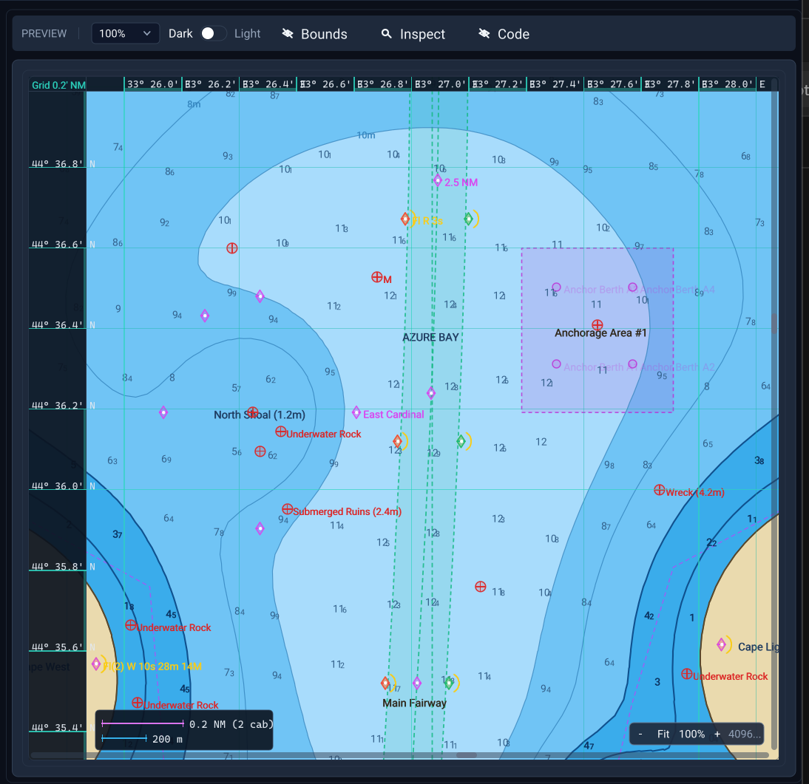

# guikit/geo

Cartography, multi-CRS geodesy, RFC 7946 GeoJSON I/O, S-52/ENC marine vector GIS rendering, OSM slippy-tile provider, and `guikit::geo::MapView` for **[GuiKit](https://github.com/guikit/guikit)**.



## Highlights

- **7 Geodetic Projections (`MapGrid`)**: `EPSG:3857` (Web Mercator), `EPSG:3395` (World Mercator), `EPSG:4326` (Plate Carrée), `UTM`, `GSK-2011`, `SK-42`, and `Arctic Polar Stereographic` / `Azimuthal`, with graticules and coordinate readouts.
- **S-57 / ENC Marine GIS Engine (`GisRenderEngine`)**: S-52 Day / Dusk / Night palettes, safety contour isobaths, spot soundings, IALA seamarks, and 256×256 vector tile caching.
- **RFC 7946 GeoJSON & OSM Slippy Tiles**: Built-in GeoJSON parser/writer (`assets/geo/demo_bay.geojson` embedded) and asynchronous HTTP tile fetcher (`OsmTileProvider`).
- **Interactive Viewport (`guikit::geo::MapView`)**: Pan, zoom, layer visibility, interactive feature picking, and custom vector overlays inside any GuiKit `Context`.

## Quick Usage

```cpp
#include "guikit/guikit.hpp"
#include "guikit/geo.hpp"

guikit::geo::MapViewOptions opts;
opts.projection = guikit::geo::MapProjection::WebMercator;
opts.height = guikit::SizeMode::Stretch;

guikit::geo::MapView(ui, mapState, opts);
```

## CMake Integration

```cmake
add_subdirectory(guikit)
add_subdirectory(geo)

target_link_libraries(my_app PRIVATE guikit::guikit guikit::geo)
```

For the unified workspace and full interactive showcase (`guikit_demo`), see **[`guikit/bundle`](https://github.com/guikit/bundle)**.

## License

BSD Zero Clause License (`0BSD`). See [LICENSE](LICENSE) for details.
